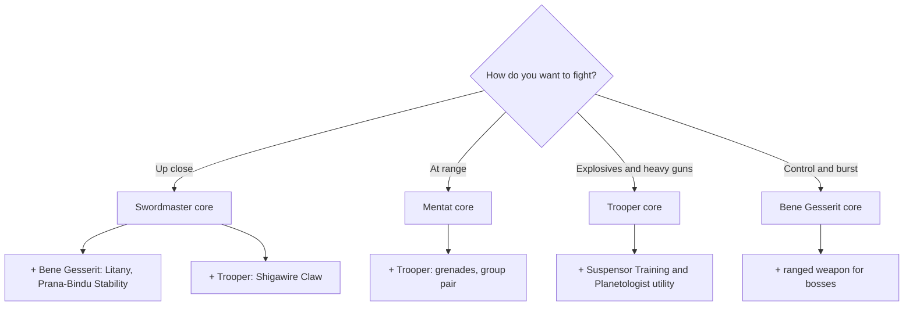

---json
{
  "schema": "dune-guide/v1",
  "title": "Combining skill trees (hybrid builds)",
  "description": "How to mix schools: the 3-ability loadout, techniques versus passives, point budget versus full-tree costs, respec cost, and the hybrid combinations guides recommend.",
  "kind": "combat-style",
  "section": "combat",
  "tags": ["build", "hybrid", "multiclass", "skill points", "loadout", "abilities", "techniques", "respec", "combination"],
  "aliases": ["multiclassing", "hybrid build", "skill loadout"],
  "related": ["combat/swordmaster-melee-build", "combat/trooper-gunner-build", "combat/bene-gesserit-build", "combat/mentat-build", "combat/planetologist-in-combat", "combat/specialization-combat-traits", "combat/prescience-in-combat"],
  "game_version": "1.5.x",
  "last_researched": "2026-10-13",
  "confidence": "medium"
}
---

# Combining skill trees (hybrid builds)

Quick answer: every character can learn every school once its trainer opens it, and you equip a loadout drawn from all of them: up to three Abilities (the third only while prescient, per the Prescience text), plus equipped Techniques, while Passives always apply (game text). Points are limited, so most builds take one main school and a few key picks from one or two others.

## The budget

- About 199 skill points from levels 2 to 200, plus Skill Points traits from the Combat specialization (+54 by level 100 per the wiki) (verified on this server for levels; wiki, https://awakening.wiki/Specialization). Full trees cost 132 (Bene Gesserit), 120 (Mentat), 136 (Planetologist) (wiki); you cannot max everything. See [../progression-and-skills.md](../progression-and-skills.md#skill-points).
- Many skills have several ranks; in 1.5 six active abilities gained three levels (Crippling Strike, Deflection, Compel, Stop, Weirding Step, Stunner) (patch notes 1.5, https://duneawakening.com/news/dune-awakening-console-release-patch-notes/).
- Loadout rules: you cannot swap abilities that are active or cooling down (game text). Respec costs Spice Melange in a watersealed base or social hub, and the price climbs with repeated respecs (game text; patch notes 1.3.0.0, see the progression chapter).

## Combinations guides recommend

| Combination | Why | Source |
|---|---|---|
| Swordmaster + Bene Gesserit + Trooper tool | Melee damage, defensive Body Control, Claw mobility | community, https://pecsandbox.com/dune-awakening-swordmaster-best-pve-build-guide/ (pre-1.5); https://vortexgaming.io/en/postdetail/664930 |
| Swordmaster + Trooper (Knee Charge, Shigawire Claw, Eye of the Storm) | One-on-one duelist | community, https://game8.co/games/Dune-Awakening/archives/532357 (date not checked) |
| Hybrid opener (Claw, Knee Charge, disruptor or scattergun, melee finish) | Works in PvE and PvP | community, https://banrado.de/en/dune-awakening-best-builds (2026-10-11) |
| Trooper + Mentat | Strong group pairing: grenades and flank control plus turrets and marks | banrado.de |
| Trooper + Planetologist + Mentat | Sustained PvE damage and positioning | community, https://pecsandbox.com/dune-awakening-trooper-best-pve-build-guide/ (pre-1.5) |
| Crafter/gatherer + one combat school | Planetologist for economy, fight with one school | inference from tree contents |

Banrado notes its school recommendations come from community guides, not Funcom. Treat any guide older than 2026-09-17 as pre-1.5.

## Cooldown and capstone pieces

Each school has a cooldown technique (Battle Hardened for Trooper, Swordmaster Cooldowns, Bene Gesserit Cooldowns, Mentat Mastery, Planetologist Cooldowns) (game text), and each school armor set lowers its own school's cooldowns (community, method.gg archetype sets). Advanced trainers unlock three capstones per school (game text).
