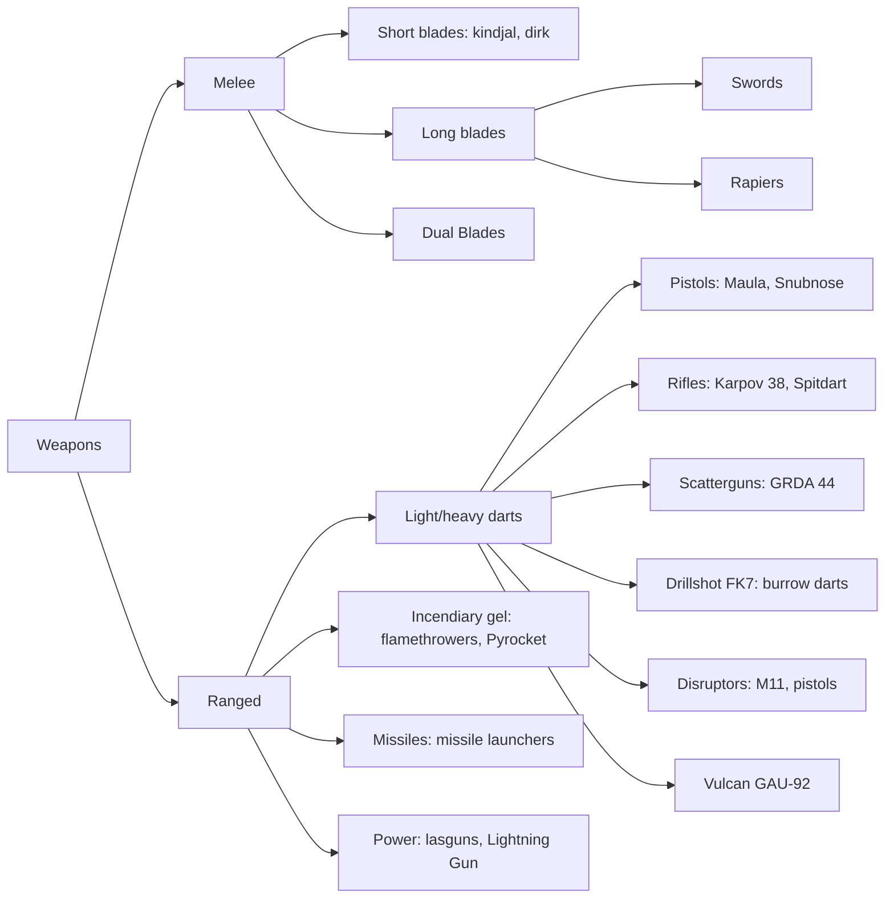

---json
{
  "schema": "dune-guide/v1",
  "title": "Combat section index",
  "description": "Overview of the combat section: fundamentals, every weapon family, armor and augments, consumables, school builds and boss tactics, with a weapon-family map.",
  "kind": "index",
  "section": "combat",
  "tags": ["combat", "index", "weapons", "armor", "builds", "bosses", "overview"],
  "aliases": ["combat guide", "fighting"],
  "related": ["combat/shields-and-the-slow-blade", "combat/weapon-tiers-and-names", "combat/combining-skill-trees", "combat/pve-boss-tactics"],
  "game_version": "1.5.x",
  "last_researched": "2026-10-13",
  "confidence": "high"
}
---

# Combat section index

Detailed combat entries for Dune: Awakening 1.5.x. The chapter [../survival-combat-crafting.md](../survival-combat-crafting.md#combat) has the short overview and [../progression-and-skills.md](../progression-and-skills.md) the skill trees and trainers. Main sources: the game text of build 25610213, item ids from `dune-awakening items find`, Funcom's 1.5 notes, and the community wiki pages edited after 2026-09-17.

The single most useful rule: shields stop fast attacks, so stagger and slow-blade, or use poison, fire, disruptors or burrow darts ([shields](shields-and-the-slow-blade.frontmatter.md)).

## Fundamentals

[Shields and the slow blade](shields-and-the-slow-blade.frontmatter.md) · [Melee attacks and stagger](melee-attacks-and-stagger.frontmatter.md) · [Blocking and parrying](blocking-and-parrying.frontmatter.md) · [Dashing](dashing-and-dodging.frontmatter.md) · [Stamina](stamina-in-combat.frontmatter.md) · [Damage types and status effects](damage-types-and-status-effects.frontmatter.md) · [Headshots and weak points](headshots-and-weak-points.frontmatter.md) · [Ranged weapons and ammo](ranged-weapons-and-ammo.frontmatter.md) · [Downed state](downed-state-and-second-wind.frontmatter.md) · [Prescience](prescience-in-combat.frontmatter.md) · [Weapon tiers and names](weapon-tiers-and-names.frontmatter.md)

## Weapon families

[Short blades](short-blades.frontmatter.md) · [Swords](swords.frontmatter.md) · [Rapiers](rapiers.frontmatter.md) · [Dual Blades](dual-blades.frontmatter.md) · [Pistols](pistols.frontmatter.md) · [Rifles](rifles.frontmatter.md) · [Scatterguns](scatterguns.frontmatter.md) · [Drillshot FK7](drillshot-shotguns.frontmatter.md) · [Disruptors](disruptors.frontmatter.md) · [Machine guns](light-machine-guns.frontmatter.md) · [Lasguns](lasguns.frontmatter.md) · [Flamethrowers and Pyrocket](flamethrowers-and-pyrocket.frontmatter.md) · [Missile launchers](missile-launchers.frontmatter.md) · [Cutteray](cutteray-in-combat.frontmatter.md) · [Unique weapons](unique-weapons.frontmatter.md)

## Armor, gear and consumables

[Light armor](light-armor.frontmatter.md) · [Heavy armor](heavy-armor.frontmatter.md) · [School armor sets](school-armor-sets.frontmatter.md) · [Stillsuits as armor](stillsuits-as-armor.frontmatter.md) · [Augments](augments.frontmatter.md) · [Shield and power pack gear](holtzman-shields-and-power-packs.frontmatter.md) · [Healkits and consumables](healkits-and-combat-consumables.frontmatter.md) · [Grenades, mines and gadgets](grenades-and-gadgets.frontmatter.md)

## Builds and bosses

[Swordmaster](swordmaster-melee-build.frontmatter.md) · [Trooper](trooper-gunner-build.frontmatter.md) · [Bene Gesserit](bene-gesserit-build.frontmatter.md) · [Mentat](mentat-build.frontmatter.md) · [Planetologist](planetologist-in-combat.frontmatter.md) · [Combining trees](combining-skill-trees.frontmatter.md) · [Specializations](specialization-combat-traits.frontmatter.md) · [Boss tactics](pve-boss-tactics.frontmatter.md)

## Open questions

- Healkit heal amounts; Second Wind trigger; Unfixed Crysknife source; whether the Cutteray damages creatures.
- Whether items have an augment slot before the first Augmentation Limit trait.
- Current 1.5 numbers for weapon damage (wiki figures predate the rework) and school armor stats (September 2025 figures).
- Tree placement of unplaced skills (Expunge, Anigolah line, Triage, The Rook, The Tower, Possfeign, Healer-Seeker).
- Where plastanium uniques not in the Testing Station drop tables come from after 1.5.
