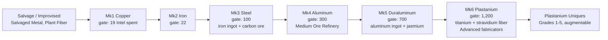
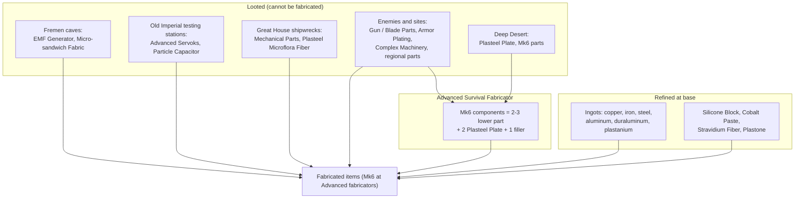

---json
{
  "schema": "dune-guide/v1",
  "title": "Crafting: tiers, research, stations, refining and costs",
  "description": "Overview of the crafting section: the six material tiers, Intel research, every crafting station, the refining chains and what major items cost, with diagrams and links to each entry.",
  "kind": "index",
  "section": "crafting",
  "tags": ["crafting", "tiers", "mk1", "mk6", "research", "intel", "fabricator", "refinery", "refining", "components", "recipes", "costs", "index"],
  "aliases": ["crafting index", "tech tree", "crafting hierarchy", "recipe guide"],
  "related": ["crafting/research-and-intel", "crafting/refining-chains", "crafting/station-progression", "crafting/worked-example-buggy-mk4", "crafting/worked-example-adept-disruptor-mk5"],
  "game_version": "1.5.x",
  "last_researched": "2026-10-13",
  "confidence": "medium"
}
---

# Crafting section

Quick answer: everything is built from six material tiers, Mk1 copper through Mk6 plastanium. You unlock designs with Intel in the Research menu, refine ore into ingots in ore and chemical refineries, add looted components (servoks, capacitors, machinery, fabrics), and fabricate at a station whose tier covers the item. The general Fabricator stops at Mk2 (iron), the four specialized fabricators cover Mk1 to Mk5, and the four Advanced fabricators make Mk6 plastanium gear (wiki station recipe lists, https://awakening.wiki/Fabricator and siblings).

## Read this before quoting a number

- **Recipe numbers are pre-1.5.** All recipe and build-cost numbers here come from awakening.wiki's generated tables. Its station pages were last edited 2026-09-05 to 2026-09-12, before 1.5 shipped on 2026-09-17. Its item pages were regenerated on 2026-10-05, but they carry the same numbers for 406 of 420 recipes compared, and they still omit changes the 1.5 notes announced. The Massive Blood Sack has no Micro-Sandwich Fabric, the Radiation Suit Mk5 and Mk6 have no Plasteel Microflora Fiber, and the Advanced fabricators still list Spice Melange (comparison made 2026-10-13; patch notes 1.5, https://duneawakening.com/news/dune-awakening-console-release-patch-notes/).
- **1.5 cost cuts.** Update 1.5 (1.5.3.0, 2026-09-17) removed Spice Melange from the build cost of the four Advanced fabricators, the Medium Chemical Refinery and the Augmentation Station. A balance pass over the aluminum, duraluminum and plastanium tiers (and plastanium grades 1 to 3) "reduced costs of several components by between 10-25%". No per-recipe numbers were published (patch notes 1.5, URL above). So for Mk4 to Mk6 items, treat the wiki numbers below as an upper bound. Copper, iron and steel tier recipes were not named in the pass.
- **This server halves crafting costs.** The server's custom settings set `CraftingCost=0.5` ("0 removes crafting costs"), `CraftingTimeMultiplier=0` (instant crafting and refining) and `BuildingCostMultiplier=1` (server config, read 2026-10-13). A player here should expect about half the listed fabrication costs, with all crafting and refining instant. Whether `CraftingCost` also scales refinery inputs is unverified; check the refinery screen.
- **Landsraad decrees** can cut costs further: "CHOAM Production Contract" reduces crafting costs by 25% and "CHOAM Refining Contract" cuts repair costs and refining times by 75% while active (game text).

## The tier ladder (diagram a)

Tier names and order (game text; vehicles chapter). Intel gates (wiki, https://awakening.wiki/Research, edited 2026-10-06). Weapon prefixes follow the same ladder: plain (Mk1), Standard (Mk2), Artisan (Mk3), House (Mk4), Adept (Mk5), Regis (Mk6) (wiki research list). Per-tier entries: [Mk1 copper](tier-mk1-copper.frontmatter.md), [Mk2 iron](tier-mk2-iron.frontmatter.md), [Mk3 steel](tier-mk3-steel.frontmatter.md), [Mk4 aluminum](tier-mk4-aluminum.frontmatter.md), [Mk5 duraluminum](tier-mk5-duraluminum.frontmatter.md), [Mk6 plastanium](tier-mk6-plastanium.frontmatter.md), [uniques](uniques-and-imperial-permits.frontmatter.md).

## How this section is organized

| Group | Entries |
|---|---|
| Systems | [research-and-intel](research-and-intel.frontmatter.md), [refining-chains](refining-chains.frontmatter.md) (diagram b), [station-progression](station-progression.frontmatter.md) (diagram c), [personal-crafting](personal-crafting.frontmatter.md), [component-families](component-families.frontmatter.md) |
| Tiers | tier-mk1-copper ... tier-mk6-plastanium, uniques-and-imperial-permits |
| Fabricators | fabricator, survival-fabricator, weapons-fabricator, garment-fabricator, vehicle-fabricator, advanced-survival-fabricator, advanced-weapons-fabricator, advanced-garment-fabricator, advanced-vehicle-fabricator |
| Refineries | small-ore-refinery, medium-ore-refinery, large-ore-refinery, small-chemical-refinery, medium-chemical-refinery, spice-refinery, medium-spice-refinery, large-spice-refinery |
| Other stations | blood-purifier, improved-blood-purifier, fremen-deathstill, advanced-fremen-deathstill, repair-station, recycler, augmentation-station |
| Refined materials | copper-ingot, iron-ingot, steel-ingot, aluminum-ingot, duraluminum-ingot, plastanium-ingot, stravidium-fiber, silicone-block, cobalt-paste, plastone, spice-melange-as-ingredient |
| Looted components | advanced-servoks, particle-capacitor, emf-generator, micro-sandwich-fabric, mechanical-parts, plasteel-microflora-fiber, complex-machinery, holtzman-actuator, armor-plating, gun-parts, blade-parts, regional-loot-components, military-power-regulator, hydraulic-piston, spice-infused-dust |
| Plastanium components | plasteel-plate, plastanium-tier-components, advanced-machinery, ballistic-weave-fabric, regis-component |
| End items | weapon-costs, armor-costs, stillsuit-costs, vehicle-module-costs, tool-costs, staking-unit, base-building-costs |
| Worked examples | [worked-example-buggy-mk4](worked-example-buggy-mk4.frontmatter.md), [worked-example-adept-disruptor-mk5](worked-example-adept-disruptor-mk5.frontmatter.md), [worked-example-advanced-fabricator](worked-example-advanced-fabricator.frontmatter.md) |

## Where the components come from (summary)

Sources: component descriptions (game text); recipes (wiki, https://awakening.wiki/Advanced_Survival_Fabricator). Details in [component-families](component-families.frontmatter.md).

## Sources

- Game text, build 25610213 (`ST_Localization_Items`, `_Buildings`, `_UI`, `_Progression`).
- Item ids: `bin/dune-awakening items find` (item data).
- awakening.wiki raw page data, fetched 2026-10-13: https://awakening.wiki/Research and each station and item page linked from the entries.
- Funcom 1.5 patch notes: https://duneawakening.com/news/dune-awakening-console-release-patch-notes/
- This server's `UserServerCustomSettings.ini` (operator override), read 2026-10-13.
