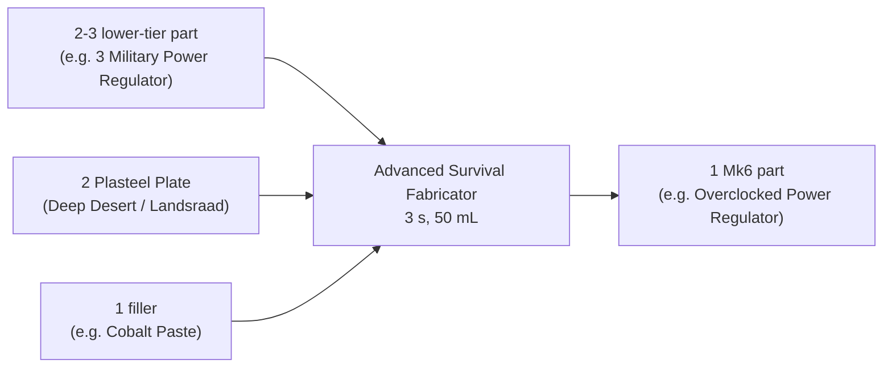

---json
{
  "schema": "dune-guide/v1",
  "title": "Plastanium-tier (Mk6) components",
  "description": "How every Mk6 crafting component is obtained: Deep Desert loot, Landsraad rewards, or an Advanced Survival Fabricator conversion of 2-3 lower parts plus 2 Plasteel Plate.",
  "kind": "system",
  "section": "crafting",
  "tags": ["mk6 components", "plastanium components", "deep desert", "plasteel", "overclocked power regulator", "tri-forged hydraulic piston", "improved holtzman actuator", "plasteel composite", "fluted compressor", "irradiated core", "watertube", "atmospheric filtered fabric"],
  "aliases": ["T6Machinery", "T6BalisticWeave", "T6PowerRegulator", "T6HydraulicPiston", "T6HoltzmanActuator", "T6IndustrialPump", "T6ArmorPlating", "T6GunPart", "T6BladePart", "T6IrradiatedCore", "T6Watertube", "T6FilteredFabric", "T6RayAmplifier", "T6RangeFinder", "T6LightCalliberCompressor", "T6HeavyCalliberCompressor", "T6CarbidePladeParts", "T6DiamodineBladeParts"],
  "related": ["crafting/plasteel-plate", "crafting/advanced-survival-fabricator", "crafting/advanced-machinery", "crafting/ballistic-weave-fabric", "crafting/regional-loot-components"],
  "game_version": "1.5.x",
  "last_researched": "2026-10-13",
  "confidence": "medium"
}
---

# Plastanium-tier components

Quick answer: each Mk6 component is "A crafting component found in the Deep Desert", and the long descriptions add "obtained from Landsraad rewards, or crafted in an Advanced Survival Fabricator" (game text). The crafted route follows one pattern: 2 or 3 of the matching lower-tier part + 2 Plasteel Plate + 1 filler (Cobalt Paste, Silicone, Spice Melange, a Duraluminum or Copper Ingot, Gun or Blade Parts, or Plant Fiber), 50 mL water, 3 s (wiki, https://awakening.wiki/Advanced_Survival_Fabricator, pre-1.5 data).

| Mk6 component (id) | Lower part x count | Filler | Main uses |
|---|---|---|---|
| [Advanced Machinery](advanced-machinery.frontmatter.md) (`T6Machinery`) | Complex Machinery x3 | Cobalt Paste | unique Mk6 engines, sandcrawler vacuum, large refineries, Augmentation Station |
| [Ballistic Weave Fabric](ballistic-weave-fabric.frontmatter.md) (`T6BalisticWeave`) | Sandtrout Leathers x3 | 2 Silicone | CHOAM Scout armor, Radiation Suit Mk6 |
| Plasteel Composite Armor Plating (`T6ArmorPlating`) | Armor Plating x3 | Spice Melange | CHOAM Heavy armor |
| Plasteel Composite Gun Parts (`T6GunPart`) | Gun Parts x3 | Spice Melange | Regis guns |
| Plasteel Composite Blade Parts (`T6BladePart`) | Blade Parts x3 | Spice Melange | Regis blades |
| Overclocked Power Regulator (`T6PowerRegulator`) | Military Power Regulator x3 | Cobalt Paste | Mk6 PSUs and generators |
| Tri-Forged Hydraulic Piston (`T6HydraulicPiston`) | Hydraulic Piston x3 | Duraluminum Ingot | Mk6 engines |
| Improved Holtzman Actuator (`T6HoltzmanActuator`) | Holtzman Actuator x3 | Cobalt Paste | Mk6 boosters, shields, compactors |
| Fluid Efficient Industrial Pump (`T6IndustrialPump`) | Industrial Pump x3 | 2 Silicone | Mk6 dew and blood tools, wings |
| Atmospheric Filtered Fabric (`T6FilteredFabric`) | Insulated Fabric x3 | 2 Plant Fiber | Mk6 literjons, blood sacks |
| Irradiated Core (`T6IrradiatedCore`) | Irradiated Slag x3 | Duraluminum Ingot | Power Pack Mk6 |
| Thermo-Responsive Ray Amplifier (`T6RayAmplifier`) | Ray Amplifier x3 | 2 Copper Ingot | Cutteray Mk6 |
| Improved Watertube (`T6Watertube`) | Stillsuit Tubing x2 | 2 Silicone (25 mL) | Mk6 stillsuits |
| Fluted Light / Heavy Caliber Compressor | Light / Heavy Caliber Compressor x2 | Gun Parts | Regis guns |
| Carbide / Diamodine blade parts | Carbide Scraps / Diamondine Dust x2 | Blade Parts | Regis blades, unique blades |
| Precision Range Finder (`T6RangeFinder`) | Range Finder x2 | Gun Parts | Mk6 rocket launchers |

Ids are item data (`T6BalisticWeave` and `T6CarbidePladeParts` are spelled that way in the game files). On Mk6 recipes the wiki data still list some unconverted parts directly (for example Regis guns take plain Light Caliber Compressors, Mk6 chassis take plain Carbide Scraps). 1.5 lowered some plastanium-tier component costs by 10 to 25% and named "Plastanium grades 1, 2, and 3" in that pass (patch notes 1.5, https://duneawakening.com/news/dune-awakening-console-release-patch-notes/); which of these conversions changed is unverified.
