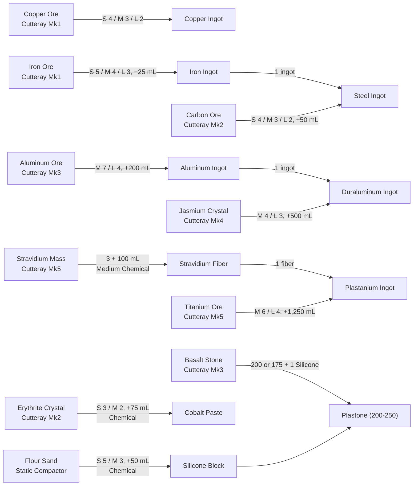

---json
{
  "schema": "dune-guide/v1",
  "title": "Refining chains: ore to ingot to component",
  "description": "Every refining chain from raw ore, sand and crystal to ingots and chemical products, with which refinery and how much ore and water each step takes.",
  "kind": "system",
  "section": "crafting",
  "tags": ["refining", "ore", "ingot", "refinery", "copper", "iron", "steel", "aluminum", "duraluminum", "plastanium", "silicone", "cobalt", "stravidium", "water"],
  "aliases": ["ore to ingot", "smelting", "refining ratios"],
  "related": ["crafting/small-ore-refinery", "crafting/medium-ore-refinery", "crafting/large-ore-refinery", "crafting/small-chemical-refinery", "crafting/medium-chemical-refinery", "crafting/plastanium-ingot", "crafting/duraluminum-ingot"],
  "game_version": "1.5.x",
  "last_researched": "2026-10-13",
  "confidence": "medium"
}
---

# Refining chains

Quick answer: copper and iron refine straight from ore; steel needs an iron ingot plus carbon ore; aluminum needs a Medium Ore Refinery; duraluminum is an aluminum ingot plus jasmium; plastanium is titanium ore plus a Stravidium Fiber made in a Medium Chemical Refinery. Bigger refineries need less ore per ingot. Numbers below are per ingot (wiki, pre-1.5 data; see [index](index.frontmatter.md)). On this server refining is instant (`CraftingTimeMultiplier=0`, server config).

## Diagram b: ore to ingot

S, M and L are the Small, Medium and Large Ore (or Chemical) Refinery. Cutteray tiers needed for each ore come from the survival chapter (wiki, https://awakening.wiki/Cutteray).

## Ore refinery recipes (wiki station pages)

| Output | Small Ore Refinery | Medium Ore Refinery | Large Ore Refinery |
|---|---|---|---|
| Copper Ingot (`CopperBar`) | 4 Copper Ore, 5 s | 3 ore, 4 s | 2 ore, 3 s |
| Iron Ingot (`IronBar`) | 5 Iron Ore + 25 mL, 10 s | 4 ore + 25 mL, 7 s | 3 ore + 25 mL, 5 s |
| Steel Ingot (`SteelBar`) | 1 Iron Ingot + 4 Carbon Ore + 50 mL, 5 s | 3 Carbon, 4 s | 2 Carbon, 3 s |
| Aluminum Ingot (`AluminiumBar`) | no | 7 Aluminum Ore + 200 mL, 30 s | 4 ore + 200 mL, 20 s |
| Duraluminum Ingot (`DuraluminumRod`) | no | 1 Aluminum Ingot + 4 Jasmium + 500 mL, 5 s | 3 Jasmium, 4 s |
| Plastanium Ingot (`T6RefinedResourceA`) | no | 6 Titanium Ore + 1 Stravidium Fiber + 1,250 mL, 30 s | 4 Titanium, 20 s |
| Plastone (`Plastone`) | 200 Basalt + 1 Silicone + 50 mL gives 200, 15 s | gives 250, 10 s | 175 Basalt gives 250, 5 s |

Sources: https://awakening.wiki/Small_Ore_Refinery, https://awakening.wiki/Medium_Ore_Refinery, https://awakening.wiki/Large_Ore_Refinery. Item ids are item data.

## Chemical refinery recipes

| Output | Small Chemical Refinery | Medium Chemical Refinery |
|---|---|---|
| Silicone Block (`Silicone`) | 5 Flour Sand + 50 mL, 15 s | 3 Flour Sand + 50 mL, 10 s |
| Cobalt Paste (`CobaltBar`) | 3 Erythrite + 75 mL, 15 s | 2 Erythrite + 75 mL, 10 s |
| Stravidium Fiber (`T6RefinedResourceB`) | no | 3 Stravidium Mass + 100 mL, 10 s |
| Small Vehicle Fuel Cell | 25 Fuel Cell, 15 s | 20 Fuel Cell, 10 s |
| Medium Sized Vehicle Fuel Cell | 45 Fuel Cell + 15 mL, 20 s | 40 + 15 mL, 15 s |
| Large Vehicle Fuel Cell | no | 80 Fuel Cell + 30 mL, 15 s |
| Low-grade Lubricant x5 | 2 Fuel Cell + 1 Silicone + 4 mL, 20 s | 1 Fuel Cell + 1 Silicone + 4 mL, 15 s |
| Industrial-grade Lubricant x10 | 8 Fuel Cell + 4 Silicone + 5 Spice Residue + 15 mL, 40 s | 6 Fuel Cell + 4 Silicone + 5 Spice Residue + 15 mL, 30 s |
| Spice-infused Fuel Cell x10 | no | 30 Fuel Cell + 65 Spice Residue + 3 Irradiated Slag + 200 mL, 30 s |

Sources: https://awakening.wiki/Small_Chemical_Refinery, https://awakening.wiki/Medium_Chemical_Refinery. Lubricants keep wind turbines running (game text).

## Spice

| Refinery | Input | Output | Time |
|---|---|---|---|
| Spice Refinery (small) | 100 Spice Sand + 750 mL | 1 Spice Melange + 5 Spice Residue | 180 s |
| Medium Spice Refinery | 750 Spice Sand + 7,000 mL | 10 Melange + 75 Residue | 450 s |
| Large Spice Refinery | 10,000 Spice Sand + 75,000 mL | 200 Melange + 1,000 Residue | 2,700 s |

Per melange that is 100, 75 and 50 sand, and 750, 700 and 375 mL water (wiki, https://awakening.wiki/Spice_Melange).

## Raw cost of one ingot from ore (computed)

| Ingot | Best route (Large) | Medium route |
|---|---|---|
| Steel | 3 Iron Ore + 2 Carbon + 75 mL | 4 Iron + 3 Carbon + 75 mL |
| Duraluminum | 4 Aluminum Ore + 3 Jasmium + 700 mL | 7 Aluminum + 4 Jasmium + 700 mL |
| Plastanium | 4 Titanium + 3 Stravidium Mass + 1,350 mL | 6 Titanium + 3 Stravidium Mass + 1,350 mL |

Computed from the tables above. Water dominates at the top: a hundred plastanium ingots need about 135 L of water.

## Notes

- "Industrial refineries require significant amounts of water" (game text, loading tip). Refineries draw from linked base storage and water (bases chapter).
- Spice Melange is the costly late ingredient: most Mk6 recipes need it, and refining it needs the most water of any chain. See [spice-melange-as-ingredient](spice-melange-as-ingredient.frontmatter.md).
- Item descriptions still say titanium refines "in a Medium Ore Refinery" and stravidium "in a Chemical Refinery" (game text); the wiki shows the fiber only in the Medium Chemical Refinery.
- Jasmium Dust (`D_JasmiumDust`) and Carbon Block (`D_Carbon`) exist as items with descriptions, but their ids carry the `D_` prefix used for deprecated items (item data), and no current recipe uses them (wiki).
