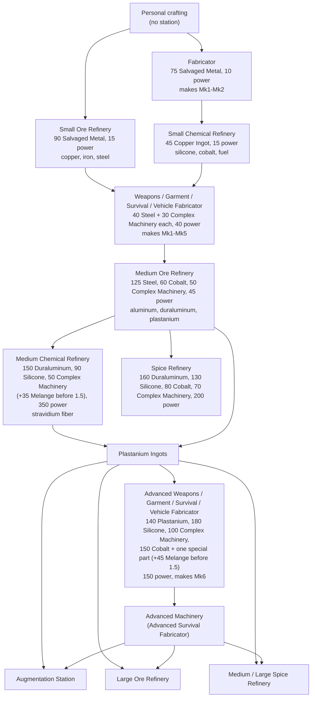

---json
{
  "schema": "dune-guide/v1",
  "title": "Crafting station progression, build costs and power",
  "description": "Which crafting and refining station to build at each tier, what each costs to build, how much power it draws and what tier it can make.",
  "kind": "system",
  "section": "crafting",
  "tags": ["stations", "fabricator", "refinery", "power", "build cost", "progression", "advanced fabricator", "base", "placeable"],
  "aliases": ["crafting stations", "workbenches", "station tiers", "what station do I need"],
  "related": ["crafting/fabricator", "crafting/advanced-weapons-fabricator", "crafting/medium-ore-refinery", "crafting/large-ore-refinery", "crafting/research-and-intel", "crafting/worked-example-advanced-fabricator"],
  "game_version": "1.5.x",
  "last_researched": "2026-10-13",
  "confidence": "medium"
}
---

# Station progression

Quick answer: start with a Fabricator and Small Ore Refinery (built from Salvaged Metal), add a Small Chemical Refinery for silicone and cobalt, then at steel build the four specialized fabricators (Weapons, Garment, Survival, Vehicle), which make everything up to Mk5. Aluminum needs a Medium Ore Refinery. Mk6 plastanium gear needs the Advanced fabricators, which cost plastanium to build, so you must first make plastanium in a Medium Ore Refinery with fiber from a Medium Chemical Refinery. All stations are placed near a Sub-Fief Console with the Construction Tool and most need base power (game text).

## Diagram c: station progression

Build costs and power (wiki station pages, pre-1.5 data); melange removal (patch notes 1.5, https://duneawakening.com/news/dune-awakening-console-release-patch-notes/).

## All stations

| Station | Build cost (wiki, pre-1.5) | Power | Research tier, Intel | Makes |
|---|---|---|---|---|
| [Fabricator](fabricator.frontmatter.md) | 75 Salvaged Metal | 10 | Salvage, 1 | Mk1-Mk2 general items (142 recipes) |
| [Survival Fabricator](survival-fabricator.frontmatter.md) | 40 Steel Ingot, 30 Complex Machinery | 40 | Steel, 5 | Tools, water gear, belts, staking units, Mk1-Mk5 |
| [Weapons Fabricator](weapons-fabricator.frontmatter.md) | 40 Steel Ingot, 30 Complex Machinery | 40 | Steel, 5 | Weapons and ammo Mk1-Mk5 |
| [Garment Fabricator](garment-fabricator.frontmatter.md) | 40 Steel Ingot, 30 Complex Machinery | 40 | Steel, 5 | Armor, stillsuits Mk1-Mk5 |
| [Vehicle Fabricator](vehicle-fabricator.frontmatter.md) | 40 Steel Ingot, 30 Complex Machinery | 40 | Steel, 5 | Vehicle modules Mk1-Mk5 |
| [Advanced Survival Fabricator](advanced-survival-fabricator.frontmatter.md) | 140 Plastanium, 180 Silicone, 100 Complex Machinery, 150 Cobalt, 30 Thermoelectric Cooler, 45 Melange* | 150 | Plastanium, 20 | Mk6 tools and water gear, Mk6 components |
| [Advanced Weapons Fabricator](advanced-weapons-fabricator.frontmatter.md) | same base + 40 Military Power Regulator, 45 Melange* | 150 | Plastanium, 20 | Mk6 weapons, augments |
| [Advanced Garment Fabricator](advanced-garment-fabricator.frontmatter.md) | same base + 115 Armor Plating, 45 Melange* | 150 | Plastanium, 20 | Mk6 armor and stillsuits, augments |
| [Advanced Vehicle Fabricator](advanced-vehicle-fabricator.frontmatter.md) | same base + 50 Industrial Pump, 45 Melange* | 150 | Plastanium, 20 | Mk6 vehicle modules |
| [Small Ore Refinery](small-ore-refinery.frontmatter.md) | 90 Salvaged Metal | 15 | Salvage, 1 | Copper, iron, steel, plastone |
| [Medium Ore Refinery](medium-ore-refinery.frontmatter.md) | 125 Steel, 60 Cobalt, 50 Complex Machinery | 45 | Aluminum, 10 | All ingots |
| [Large Ore Refinery](large-ore-refinery.frontmatter.md) | 380 Plastanium, 540 Silicone, 400 Melange, 200 Complex Machinery, 745 Cobalt, 40 Advanced Machinery | not listed | Plastanium, 20 | All ingots, best ratios |
| [Small Chemical Refinery](small-chemical-refinery.frontmatter.md) | 45 Copper Ingot | 15 | Salvage, 1 | Silicone, cobalt, fuel, lubricant |
| [Medium Chemical Refinery](medium-chemical-refinery.frontmatter.md) | 150 Duraluminum, 90 Silicone, 50 Complex Machinery, 35 Melange* | 350 | Plastanium, 20 | Adds stravidium fiber, spice fuel |
| [Spice Refinery](spice-refinery.frontmatter.md) | 160 Duraluminum, 130 Silicone, 80 Cobalt, 70 Complex Machinery | 200 | Duraluminum, 30 (game text says steel) | Melange |
| [Medium Spice Refinery](medium-spice-refinery.frontmatter.md) | 285 Plastanium, 225 Silicone, 135 Melange, 100 Complex Machinery, 190 Cobalt | 350 | Plastanium, 20 | Melange |
| [Large Spice Refinery](large-spice-refinery.frontmatter.md) | 950 Plastanium, 1,080 Silicone, 350 Complex Machinery, 1,000 Melange, 1,110 Cobalt, 55 Advanced Machinery | 500 | Plastanium, 40 | Melange |
| [Blood Purifier](blood-purifier.frontmatter.md) | 70 Salvaged Metal | 10 | Salvage, 1 | Water from blood |
| [Improved Blood Purifier](improved-blood-purifier.frontmatter.md) | 50 Iron Ingot, 16 Silicone, 20 Complex Machinery | 35 | Iron, 5 | Water from blood |
| [Fremen Deathstill](fremen-deathstill.frontmatter.md) | 60 Steel, 28 Silicone, 32 Complex Machinery | 200 | Steel, 0 (journey) | Water from corpses |
| [Advanced Fremen Deathstill](advanced-fremen-deathstill.frontmatter.md) | 240 Duraluminum, 170 Silicone, 70 Complex Machinery | 350 | Duraluminum, 30 | Water from corpses |
| [Repair Station](repair-station.frontmatter.md) | 40 Iron Ingot | 20 | Iron, 3 | Repairs |
| [Recycler](recycler.frontmatter.md) | 30 Copper Ingot | 15 | Copper, 2 | Salvage materials |
| [Augmentation Station](augmentation-station.frontmatter.md) | 75 Plastanium, 180 Silicone, 50 Complex Machinery, 15 Melange*, 75 Cobalt, 10 Advanced Machinery | 50 | Plastanium, 20 | Applies augments |

\* Melange marked with an asterisk was removed from these six build costs in 1.5 (patch notes 1.5). The remaining aluminum to plastanium tier costs may also be 10 to 25% lower in 1.5 (same notes; no per-item figures). On this server `BuildingCostMultiplier=1`, so placeables cost the listed amount (server config; whether station build costs follow `BuildingCostMultiplier` or `CraftingCost` is unverified).

## Power budget

A first base with a Fabricator, Small Ore and Chemical Refineries, Blood Purifier and Repair Station draws about 70; a Fuel-Powered Generator gives 75 (bases chapter, wiki). The four specialized fabricators add 160 and a Medium Chemical Refinery 350, and the four Advanced fabricators add 600, so endgame bases need wind turbines or the Spice-Powered Generator (1,000) (bases chapter). The game's own journey text warns that the specialized fabricators' "combined power draw is significant" and suggests powering them off from their management consoles when idle (game text). Station power draw is from wiki infoboxes (pre-1.5).

## Station tier ceilings

Counting the ingots used in each station's recipe list: the Fabricator uses only copper and iron; the four specialized fabricators use copper through duraluminum; the four Advanced fabricators use plastanium (one or two duraluminum or copper exceptions for components) (wiki recipe lists, analyzed 2026-10-13). The UI card "Fabricates up to:" shows each station's ceiling in game (game text).
