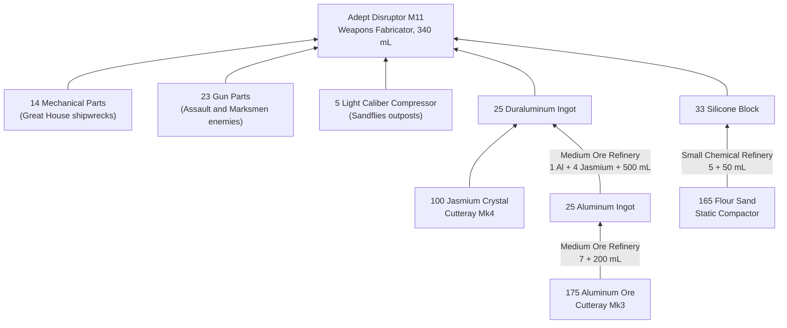

---json
{
  "schema": "dune-guide/v1",
  "title": "Worked example: an Adept Disruptor M11 (Mk5 weapon)",
  "description": "Everything needed for one Mk5 duraluminum weapon, the Adept Disruptor M11, from raw ore: Intel, stations, loot, ore and water, as a dependency graph.",
  "kind": "recipe",
  "section": "crafting",
  "tags": ["worked example", "adept", "disruptor m11", "mk5 weapon", "duraluminum", "how to craft", "dependency graph"],
  "aliases": ["Adept Disruptor M11 recipe"],
  "related": ["crafting/weapon-costs", "crafting/weapons-fabricator", "crafting/duraluminum-ingot", "crafting/tier-mk5-duraluminum", "crafting/mechanical-parts"],
  "game_version": "1.5.x",
  "last_researched": "2026-10-13",
  "confidence": "medium"
}
---

# Worked example: Adept Disruptor M11

Quick answer: 25 Duraluminum Ingot, 14 Mechanical Parts, 33 Silicone Block, 23 Gun Parts, 5 Light Caliber Compressor and 340 mL water at a Weapons Fabricator, 15 s (wiki, https://awakening.wiki/Weapons_Fabricator, pre-1.5; 1.5 cut some duraluminum-tier costs by 10 to 25%, and this server halves fabrication costs, `CraftingCost=0.5`, server config). From raw: 175 Aluminum Ore, 100 Jasmium Crystal, 165 Flour Sand and about 19.5 L of water.

| Need | Detail |
|---|---|
| Intel | 700 spent for duraluminum; the schematic 30; Weapons Fabricator 5; Medium Ore Refinery 10 (wiki, https://awakening.wiki/Research) |
| Stations | Weapons Fabricator (40 Steel, 30 Complex Machinery), Medium Ore Refinery, Small Chemical Refinery |
| Water | 5,000 mL (aluminum) + 12,500 mL (duraluminum) + 1,650 mL (silicone) + 340 mL = 19,490 mL (computed) |

The Medium Chemical Refinery (plastanium tier) would cut flour sand to 99. Component sources: game text descriptions ([component-families](component-families.frontmatter.md), [regional-loot-components](regional-loot-components.frontmatter.md)). For comparison, the House (Mk4) version is 18 Aluminum, 11 Mechanical Parts, 17 Silicone, 17 Gun Parts, 4 compressors, and the Regis (Mk6) version 30 Plastanium plus 25 Melange and Plasteel Composite Gun Parts ([weapon-costs](weapon-costs.frontmatter.md)).
