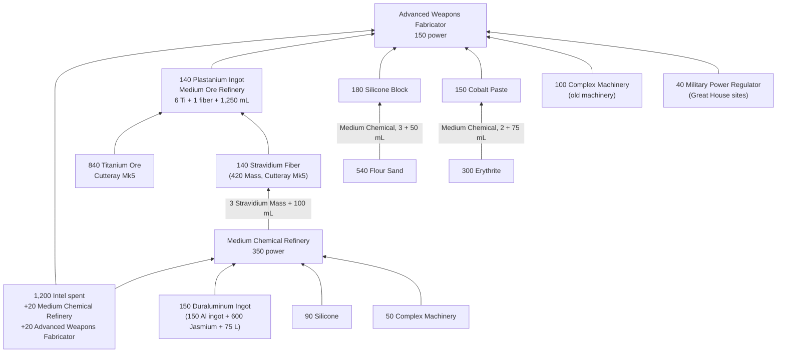

---json
{
  "schema": "dune-guide/v1",
  "title": "Worked example: building your first Advanced fabricator",
  "description": "What it takes to place an Advanced Weapons Fabricator from scratch: the plastanium chain, the Medium Chemical Refinery prerequisite, materials, ore and water, as a dependency graph.",
  "kind": "recipe",
  "section": "crafting",
  "tags": ["worked example", "advanced weapons fabricator", "advanced fabricator", "mk6", "plastanium", "first plastanium", "endgame", "dependency graph"],
  "aliases": ["how to get an advanced fabricator"],
  "related": ["crafting/advanced-weapons-fabricator", "crafting/plastanium-ingot", "crafting/medium-chemical-refinery", "crafting/tier-mk6-plastanium", "crafting/station-progression"],
  "game_version": "1.5.x",
  "last_researched": "2026-10-13",
  "confidence": "medium"
}
---

# Worked example: your first Advanced fabricator

Quick answer: an Advanced Weapons Fabricator costs 140 Plastanium Ingot, 180 Silicone Block, 100 Complex Machinery, 150 Cobalt Paste and 40 Military Power Regulator (plus 45 Spice Melange before 1.5) (wiki, https://awakening.wiki/Advanced_Weapons_Fabricator, pre-1.5; patch notes 1.5 removed the melange). The 140 plastanium alone needs 840 Titanium Ore, 420 Stravidium Mass and about 189 L of water, and first you must build a Medium Chemical Refinery for the fiber. The other three Advanced fabricators differ only in their special part (30 Thermoelectric Cooler, 115 Armor Plating or 50 Industrial Pump).

## Water budget (computed)

| Step | Water |
|---|---|
| 140 Plastanium Ingot (1,250 mL each) | 175,000 mL |
| 140 Stravidium Fiber (100 mL each) | 14,000 mL |
| 180 Silicone (50 mL each) | 9,000 mL |
| 150 Cobalt (75 mL each) | 11,250 mL |
| Total for the fabricator | 209,250 mL |
| Medium Chemical Refinery's 150 Duraluminum (incl. aluminum) | 105,000 mL |

A Large Ore Refinery would cut titanium to 560 but costs 380 plastanium itself, so it comes later (wiki). With 1.5's plastanium-tier cuts the real numbers may be 10 to 25% lower; this server's `BuildingCostMultiplier=1` leaves placeable costs at default, while fabricated items cost half (`CraftingCost=0.5`, server config); whether that also halves refinery inputs is unverified.

## Power

The Medium Chemical Refinery (350) plus one Advanced fabricator (150) adds 500 power, more than six Fuel-Powered Generators (75 each) (wiki infoboxes; bases chapter). Plan wind turbines or a Spice-Powered Generator (1,000).
