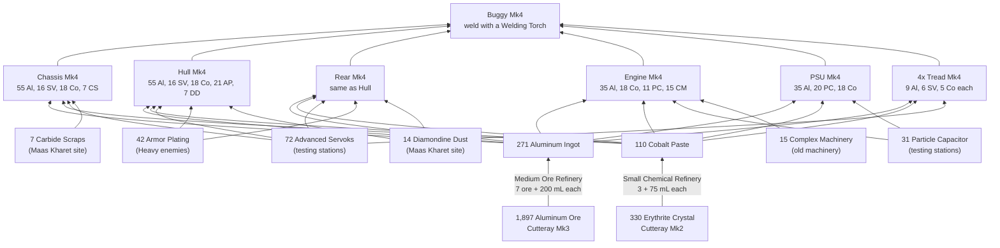

---json
{
  "schema": "dune-guide/v1",
  "title": "Worked example: building a Mk4 (aluminum) buggy",
  "description": "Everything needed to build a Mk4 buggy from raw ore: Intel, stations, every module recipe, the loot shopping list, ore and water totals, as a dependency graph.",
  "kind": "recipe",
  "section": "crafting",
  "tags": ["worked example", "buggy", "buggy mk4", "aluminum", "how to build a buggy", "shopping list", "vehicle", "dependency graph"],
  "aliases": ["Mk4 buggy cost", "Buggy Mk4 Assembly"],
  "related": ["crafting/vehicle-module-costs", "crafting/vehicle-fabricator", "crafting/aluminum-ingot", "crafting/tier-mk4-aluminum", "crafting/advanced-servoks"],
  "game_version": "1.5.x",
  "last_researched": "2026-10-13",
  "confidence": "medium"
}
---

# Worked example: a Mk4 buggy

Quick answer: a Mk4 buggy (Chassis, Hull, Rear, Engine, PSU, 4 Treads) costs 271 Aluminum Ingot, 110 Cobalt Paste, 72 Advanced Servoks, 42 Armor Plating, 31 Particle Capacitor, 15 Complex Machinery, 14 Diamondine Dust, 7 Carbide Scraps and 3,060 mL water at a Vehicle Fabricator. From raw that is about 1,900 Aluminum Ore, 330 Erythrite and 65 L of water (computed from wiki recipe data, pre-1.5; 1.5 cut some aluminum-tier costs by 10 to 25%, and this server's `CraftingCost=0.5` halves fabrication costs, server config).

## Dependency graph

Each module is fabricated in a Vehicle Fabricator, 20 s and 340 mL water each (wiki, https://awakening.wiki/Vehicle_Fabricator). The Utility Rear costs the same as the Rear and swaps the two passenger seats for a turret slot (wiki; vehicles chapter).

## Prerequisites

| Need | Detail |
|---|---|
| Intel | 300 spent to open aluminum; Buggy Mk4 Assembly 30, Medium Ore Refinery 10, Vehicle Fabricator 5 (steel) (wiki, https://awakening.wiki/Research) |
| Stations | Vehicle Fabricator (40 Steel, 30 Complex Machinery, 40 power); Medium Ore Refinery (125 Steel, 60 Cobalt, 50 Complex Machinery, 45 power); Small Chemical Refinery (45 Copper) |
| Tools | Cutteray Mk3 (aluminum ore), Welding Torch (Mk1 is 6 Copper) |

The Medium Chemical Refinery would cut erythrite to 220, but it is a plastanium-tier research, so at Mk4 the small one is the realistic route. A Large Ore Refinery would cut aluminum ore to 1,084 but is also plastanium tier.

## Water

54,200 mL to refine the aluminum, 8,250 mL for the cobalt, 3,060 mL in the modules: 65,510 mL in total (computed).

## Optional extras (wiki)

Booster Mk4 60 Aluminum, 40 Particle Capacitor, 30 Cobalt, 31 Holtzman Actuator; Storage Mk4 55 Aluminum, 16 Servoks, 14 Cobalt; Cutteray Mk4 70 Aluminum, 30 Particle Capacitor, 27 Cobalt, 15 Ray Amplifier.
