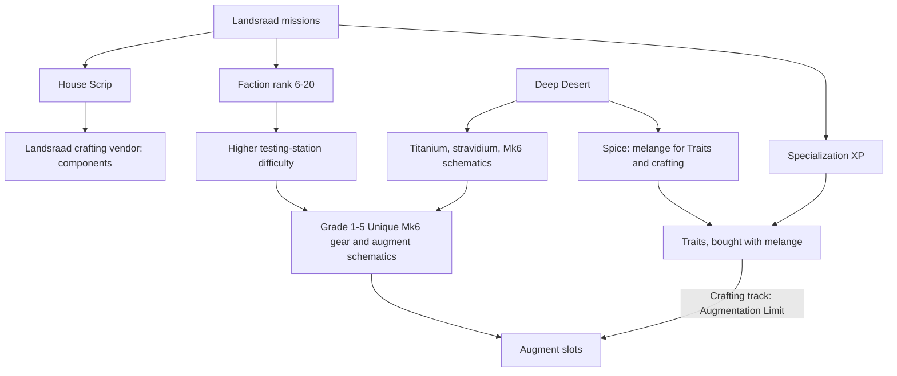

---json
{
  "schema": "dune-guide/v1",
  "title": "Endgame (section overview)",
  "description": "What there is to do at maximum level in 1.5 and where each activity is described: Deep Desert, Landsraad, Specializations, graded Mk6 gear and augments, challenge testing stations, story finale, base and economy goals, and how it all plays on a private two-player world.",
  "kind": "index",
  "section": "endgame",
  "tags": ["endgame", "max level", "what to do", "late game", "deep desert", "landsraad", "specializations", "augments", "testing stations", "mk6", "index"],
  "aliases": ["end game", "post-story", "late game"],
  "related": ["spice/index"],
  "game_version": "1.5.x",
  "last_researched": "2026-10-13",
  "confidence": "high"
}
---

# Endgame

In 1.5, endgame means improving a character who already has Plastanium (Mk6) gear: higher gear grades and augments from repeatable Imperial Testing Stations, Specialization levels and Traits from Landsraad missions, faction rank up to 20, and Deep Desert spice and loot runs (community, https://boostroom.com/blog/dune-awakening-update-15-guide-new-endgame-progression-major-changes, 2026-09-29; 1.5 announcement). PvP is optional on official worlds and absent from full progression requirements (same sources).

| Entry | Covers |
|---|---|
| [deep-desert](deep-desert.frontmatter.md) | Weekly Coriolis wipe, PvE and PvP instances, resources, control points, grandfather worms |
| [deep-desert-loot-and-schematics](deep-desert-loot-and-schematics.frontmatter.md) | Where Mk6 and Unique schematics drop, weekly rotation, testing stations and wrecks |
| [challenge-testing-stations](challenge-testing-stations.frontmatter.md) | The repeatable Overland dungeons, difficulty levels, loot grades, faction-rank gate |
| [gear-grades-and-augments](gear-grades-and-augments.frontmatter.md) | Mk6 tier, Uniques, Grades 1 to 5, the Augmentation Station |
| [specializations](specializations.frontmatter.md) | The five tracks, per-level bonuses, Traits and their melange cost |
| [landsraad](landsraad.frontmatter.md) | Weekly terms, Houses, missions, control points, decrees, faction ranks |
| [story-finale-and-sardaukar](story-finale-and-sardaukar.frontmatter.md) | The Great Convention Part III, the Sardaukar Orbital Bastion, Filmic Archive DLC |
| [base-and-economy-endgame](base-and-economy-endgame.frontmatter.md) | Late-game base goals, power, refining, protection tools, money |
| [whats-new-in-1-5](whats-new-in-1-5.frontmatter.md) | The endgame-relevant changes of the 1.5 release |
| [private-two-player-world](private-two-player-world.frontmatter.md) | How this server's settings change the endgame for two players |

Related chapters: [../progression-and-skills.md](../progression-and-skills.md), [../world-and-maps.md](../world-and-maps.md), [../economy-social-versions.md](../economy-social-versions.md), and the [spice section](../spice/index.frontmatter.md).
