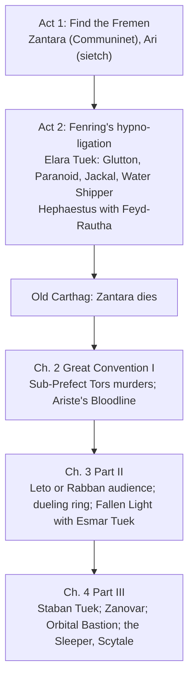

---json
{
  "schema": "dune-guide/v1",
  "title": "NPCs: index",
  "description": "Index of named NPCs and NPC groups in Dune: Awakening 1.5.x by role and location: trainers, vendors, faction contacts, story quest givers, bankers, bosses and enemy factions.",
  "kind": "index",
  "section": "npcs",
  "tags": ["index", "npc", "trainer", "vendor", "merchant", "faction", "quest giver", "boss", "enemy", "where is"],
  "aliases": ["NPC list", "who sells what", "where are the trainers"],
  "region": "Hagga Basin, Arrakeen, Harko Village, story maps",
  "related": ["npcs/ghavouri", "npcs/anton-tolliver", "npcs/elara-tuek", "npcs/kirab"],
  "game_version": "1.5.x",
  "last_researched": "2026-10-13",
  "confidence": "high"
}
---

One entry per important NPC or group. Names, contract titles and journey text come from the game's string table (build 25610213); exact stand positions and shop stock mostly come from awakening.wiki (pages edited 2026-09-29 to 2026-10-14) and are tagged in each entry. Shop inventories and prices change with patches; treat wiki stock lists as a guide.

Map: tradeposts hold the first trainers, the Atreides and Harkonnen recruiters (The Anvil) and Landsraad representatives; Arrakeen and Harko Village hold the advanced trainers, most vendors, bankers and the main story contacts.

## Trainers

| School | Basic trainer (where) | Advanced trainer (where) |
|---|---|---|
| Trooper | [Ghavouri](ghavouri.frontmatter.md) (Griffin's Reach) | [Kara Valk](kara-valk.frontmatter.md) (Arrakeen) |
| Swordmaster | [Arno](arno.frontmatter.md) (Pinnacle Station) | [Seron Varlin](seron-varlin.frontmatter.md) (Harko Village) |
| Mentat | [Samin Moro](samin-moro.frontmatter.md) (Riftwatch) | [Zayn de Witte](zayn-de-witte.frontmatter.md) (Arrakeen) |
| Bene Gesserit | [Sister Mesa](sister-mesa.frontmatter.md) (Helius Gate) | [Jocasta Cleo](jocasta-cleo.frontmatter.md) (Harko Village) |
| Planetologist | [Derek Chinara](derek-chinara.frontmatter.md) (above Testing Station No. 2) | same NPC |

Advanced trainers stand in Arrakeen and Harko Village, not in the Hagga Basin regions their map keys suggest (game text; see `progression-and-skills.md`). Also listed as a trainer: [PAL](pal.frontmatter.md) (Lost Harvest, Testing Station No. 163).

## Vendors and services

| Where | NPCs |
|---|---|
| Griffin's Reach | [Myr Charki](myr-charki.frontmatter.md) (early gear, components) |
| The Anvil | [Tyg Rolsum](tyg-rolsum.frontmatter.md) (trader, contracts) |
| Pinnacle Station | [Traj Axxari](traj-axxari.frontmatter.md) (weapons, Old Imperial components; Gloos Bohannon), [Tleilaxu Trader](tleilaxu-trader.frontmatter.md) |
| Arrakeen | [Ant Nostrum](ant-nostrum.frontmatter.md) (weapons, unique schematics), [Beatriz Luna](beatriz-luna.frontmatter.md) (vehicles), [Soha Sirrendrin](soha-sirrendrin.frontmatter.md) (CHOAM components), [Tidjii and Phin O'Garee](tidjii-and-phin-ogaree.frontmatter.md) (scrap; black-market Harkonnen variants), Campos Demari, Daimo Sharawi, Salusan Bull bartenders ([spice and water sellers](spice-and-water-sellers.frontmatter.md)) |
| Harko Village | [Asmara Efendi](asmara-efendi.frontmatter.md) (weapons), [Kahraman Reis](kahraman-reis.frontmatter.md) (vehicles), [Ranya Sorvane](ranya-sorvane.frontmatter.md) (scrap), [Ormuna Laaks](ormuna-laaks.frontmatter.md) (Atreides building set, armor variants), [Anoushka Hannivar](anoushka-hannivar.frontmatter.md) (bar, Sapho Juice, clothing), [Black Market Trader](black-market-trader.frontmatter.md), Einar Maia and Ajani Kassa ([spice and water sellers](spice-and-water-sellers.frontmatter.md)) |
| Both cities | [Faction quartermasters](faction-quartermasters.frontmatter.md), [Landsraad vendors](landsraad-vendors.frontmatter.md), [bankers and city services](bankers-and-city-services.frontmatter.md), [recustomizers](recustomizers.frontmatter.md) |
| Neo Carthag Arena | [Duel Ring Vendor](duel-ring-vendor.frontmatter.md) |

## Factions and the Landsraad

| Tier | Atreides | Harkonnen |
|---|---|---|
| Recruiter (The Anvil) | [Anton Tolliver](anton-tolliver.frontmatter.md) | [Maxim Kazmir](maxim-kazmir.frontmatter.md) |
| Officer | [Andrea Ganan](andrea-ganan.frontmatter.md) (Helius Gate) | [Simone Von Konig](simone-von-konig.frontmatter.md) (Riftwatch) |
| Master of Assassins | [Thufir Hawat](thufir-hawat.frontmatter.md) (Arrakeen) | [Piter de Vries](piter-de-vries.frontmatter.md) (Harko Village) |
| Leader | [Duke Leto Atreides](duke-leto-atreides.frontmatter.md) | [Glossu Rabban](glossu-rabban.frontmatter.md) |

The tier labels are an editorial grouping from the wiki's descriptions and the contract chains, not game terms. Minor houses: [Landsraad house representatives](landsraad-house-representatives.frontmatter.md).

## Story

Chapter order from journey keys and texts (game text); the chapter numbering follows `progression-and-skills.md`. Entries: [Zantara](zantara.frontmatter.md), [Ariste Atreides](ariste-atreides.frontmatter.md), [Elara Tuek](elara-tuek.frontmatter.md), [Count Hasimir Fenring](hasimir-fenring.frontmatter.md), [Feyd-Rautha](feyd-rautha.frontmatter.md), [Sub-Prefect Tors and the Arrakeen murders](sub-prefect-tors.frontmatter.md), [Esmar and Staban Tuek](esmar-tuek.frontmatter.md), [the Sleeper](the-sleeper.frontmatter.md), [Scytale](scytale.frontmatter.md), [the Guide](the-guide.frontmatter.md), [the Fremen](the-fremen.frontmatter.md). Side lines: [Cyprian Io](cyprian-io.frontmatter.md) (Planetologist chain), [Keif Villari and the Lost Harvest NPCs](keif-villari.frontmatter.md) (DLC).

## Bosses

| Boss | Where | Entry |
|---|---|---|
| The Glutton | Hand of Khidr / Glutton's dining room, Jabal Eifrit | [the-glutton](the-glutton.frontmatter.md) |
| The Paranoid and her Chosen | Mysa Tarill / The O'odham | [the-paranoid](the-paranoid.frontmatter.md) |
| The Jackal | Arrakeen alleys | [the-jackal](the-jackal.frontmatter.md) |
| Brute, Aren, Master of Chains, Thrax, Sinnu | dueling ring near Neo Carthag | [arena-fighters](arena-fighters.frontmatter.md) |
| The Minotaur (Face Dancer as Esmar Tuek) | Fallen Light | [esmar-tuek](esmar-tuek.frontmatter.md) |
| Lt. Aman, Masano, Takulki, Burrbridge, Dr. Lemenger | challenge Testing Stations 89, 136, 152, 195, 24 | [testing-station-bosses](testing-station-bosses.frontmatter.md) |
| Commander Aramsham | Sardaukar Orbital Bastion | [commander-aramsham](commander-aramsham.frontmatter.md) |
| Lazaro Fein | Vermillius Gap (Kirab) | [kirab](kirab.frontmatter.md) |
| Colonel Keil, Cassian, Leon | Hagga Rift, Blushing Cavern | [deserters](deserters.frontmatter.md) |
| The Ghost of Tsimpo | Ruins of Tsimpo | [ghosts-of-tsimpo](ghosts-of-tsimpo.frontmatter.md) |
| Kade Rin, Ren Qaoli | Wind Pass | [water-shippers](water-shippers.frontmatter.md) |

## Enemy factions by region

| Region | Group |
|---|---|
| Hagga Basin South | [Scavengers](scavengers.frontmatter.md) |
| Vermillius Gap | [Kirab](kirab.frontmatter.md) |
| Jabal Eifrit | [Slavers](slavers.frontmatter.md); [Sardaukar](sardaukar.frontmatter.md) dropships at night |
| Hagga Rift | [Deserters](deserters.frontmatter.md); Atreides and Harkonnen troops |
| Shield Wall | [Sandflies](sandflies.frontmatter.md) |
| Mysa Tarill, The O'odham | [Maas Kharet](maas-kharet.frontmatter.md) |
| Wind Pass, Old Quarry, Polar Sink | [Water Shippers](water-shippers.frontmatter.md) |
| Story levels | [Smugglers](smugglers.frontmatter.md), [Sardaukar](sardaukar.frontmatter.md) |

Region-to-group assignments are the game's own region names ("Scavenger Territory", "Kirab Territory", and so on; game text).

## Open questions

- Exact positions of Kara Valk, Zayn de Witte, Seron Varlin and Jocasta Cleo inside the cities (wiki gives districts; unverified here).
- Which NPC offers each defection contract; the string table and the wiki disagree in places (see Thufir Hawat, Maxim Kazmir).
- Where Lazaro Fein, the challenge Testing Stations and the Pilgrims Camp are on the map.
- Whether the self-hosted Exchange also acts as a vendor, as in single-player 1.5 (see `economy-social-versions.md`).
