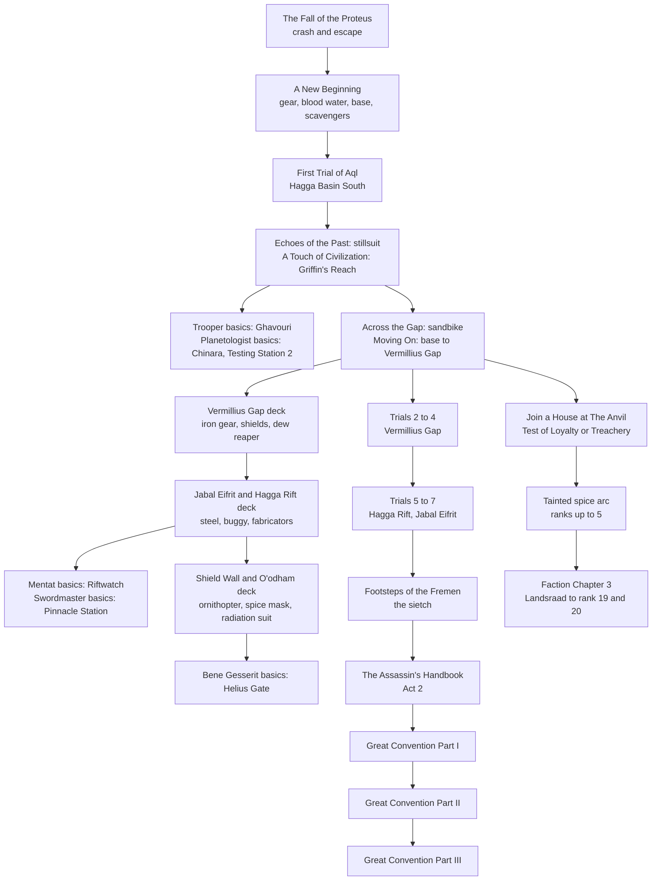

---json
{
  "schema": "dune-guide/v1",
  "title": "Quests and journeys (section index)",
  "description": "Overview of the quests section and a suggested early-to-mid progression path through the story, Trials of Aql, trainers, factions and regional journeys.",
  "kind": "index",
  "section": "quests",
  "tags": ["quests", "journey", "story", "walkthrough", "progression path", "what should i do next", "order", "main story", "side quests"],
  "aliases": ["quest index", "journey index", "story order"],
  "region": "All",
  "related": ["quests/the-fall-of-the-proteus", "quests/a-new-beginning", "quests/trials-of-aql", "quests/faction-join-a-house", "quests/regional-journeys", "quests/contracts"],
  "game_version": "1.5.x",
  "last_researched": "2026-10-13",
  "confidence": "medium"
}
---

# Quests and journeys

The game tracks story and side quests as Journey decks of cards (each card a quest with steps) plus contracts from boards and NPCs (game text). This section has one entry per questline. Overviews of XP, schools and factions are in [progression-and-skills.md](../progression-and-skills.md); places are in [world-and-maps.md](../world-and-maps.md).

Sources for the whole section: the game's English strings from build 25610213 (`PROGRESSION/JOURNEY_*`, `PROGRESSION/EARLYJOURNEY_*`, `LORE_PICKUPS_AND_CONTRACTS/*`, `UI/CONTRACTS_*`, dialogue subtitles), the wiki's Journeys and Faction pages (October 2026), Funcom's 1.5 announcement, and community guides marked per fact. Step order within a card is taken from the string table and card text; where the game gives no order, the entry says so.

## Suggested path (early to mid game)

The path is a suggestion built from the journey prerequisites in the game text: the sandbike before the Vermillius Gap, the fourth trial before the Thumper card, the faction notices' "VEHICLE NEEDED IF CROSSING FROM THE SOUTH", and the Act 2 trigger after the sietch Epilogue. Story chapters, trainers, factions and regional decks run in parallel; the story's later errands reach the Sheol and the Deep Desert, so gear from the regional decks matters.

## Entries

Main story, in order:
1. [The Fall of the Proteus](the-fall-of-the-proteus.frontmatter.md): opening crash and escape.
2. [A New Beginning](a-new-beginning.frontmatter.md): Hagga Basin South survival tutorial to the sandbike.
3. [The Test of Aql](trials-of-aql.frontmatter.md): the seven Fremen vision trials.
4. [The Footsteps of the Fremen](footsteps-of-the-fremen.frontmatter.md): the sietch and the Act 1 Epilogue.
5. [The Assassin's Handbook](the-assassins-handbook.frontmatter.md): Act 2, Fenring's assassinations, Old Carthag.
6. [The Great Convention, Part I](great-convention-part-1.frontmatter.md): Chapter 2 investigation.
7. [The Great Convention, Part II](great-convention-part-2.frontmatter.md): Chapter 3 arena and Fallen Light.
8. [The Great Convention, Part III](great-convention-part-3.frontmatter.md): Chapter 4 finale (update 1.5).

Factions:
- [Join a House](faction-join-a-house.frontmatter.md): The Anvil, loyalty tests, ranks 0 to 5.
- [The tainted spice investigation](faction-tainted-spice.frontmatter.md): Kytheria, Skorda, the Sheol.
- [Faction Chapter 3 journeys](faction-chapter-3.frontmatter.md): Landsraad, augmentation, rank 20, overland dungeons.

Skill-tree trainers (each basic contract opens a tree):
- [Trooper](trooper-training.frontmatter.md): Ghavouri, Griffin's Reach; Kara Valk, Arrakeen.
- [Planetologist](planetologist-training.frontmatter.md): Derek Chinara above Testing Station No. 2.
- [Mentat](mentat-training.frontmatter.md): Samin Moro, Riftwatch; Zayn de Witte, Arrakeen. Includes [Calculated Calamity](calculated-calamity.frontmatter.md).
- [Swordmaster](swordmaster-training.frontmatter.md): Arno, Pinnacle Station; Seron Varlin, Harko Village.
- [Bene Gesserit](bene-gesserit-training.frontmatter.md): Sister Mesa, Helius Gate; Jocasta Cleo, Harko Village.

Systems and side content:
- [Contracts](contracts.frontmatter.md): types, pay, chains by region.
- [Regional journey decks](regional-journeys.frontmatter.md): gear and exploration checklists per region.
- [Lost Harvest](lost-harvest.frontmatter.md): paid DLC story.
- [The Song of Shai-Hulud](song-of-shai-hulud.frontmatter.md): after a worm eats you.

## Open questions

- Which trainer and faction contracts grant which unlock or rank (the strings name rewards only generically).
- Whether the Thumper comes from the fourth trial (game text "Calling the Worm") or the fifth (method.gg).
- The cause of the "Connecting..." hang seen at the end of an Aql vision on this server on 2026-10-13.
- Whether patch 1.5.15.0's journey XP for Chapters 3 and 4 is in this server's build.
- Exact Solari amounts for contracts and the Chapter 4 spice bribe.
