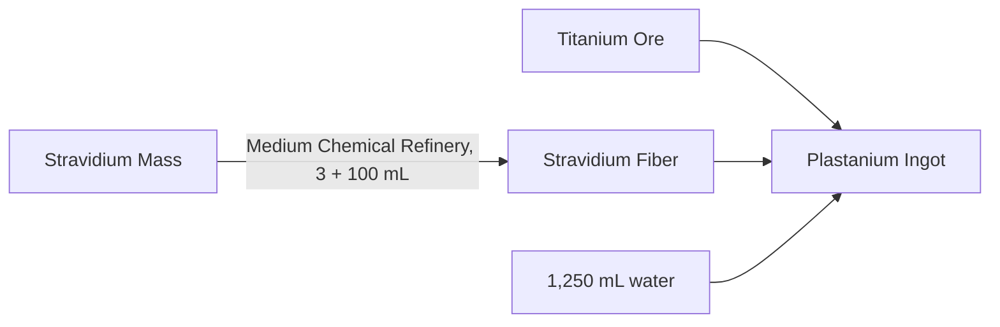

---json
{
  "schema": "dune-guide/v1",
  "title": "Plastanium Ingot",
  "description": "Tier 6 endgame alloy of Titanium Ore and Stravidium Fiber made in a Medium or Large Ore Refinery; used for plastanium gear, Mk6 tools and vehicles.",
  "kind": "resource",
  "section": "resources",
  "tags": ["plastanium", "ingot", "tier 6", "refining", "titanium", "stravidium", "endgame", "alloy"],
  "aliases": ["T6RefinedResourceA", "plast", "plastanium bar"],
  "related": ["resources/titanium-ore", "resources/stravidium-fiber", "resources/stravidium-mass", "resources/rare-resources"],
  "game_version": "1.5.x",
  "last_researched": "2026-10-13",
  "confidence": "high"
}
---

# Plastanium Ingot

"Pure titanium is extracted from its ore, heated until liquid, and then carefully threaded with stravidium fibers to enhance its strength" (game text). Item id `T6RefinedResourceA`, stacks to 500 (item data).

| Refinery | Input | Time |
|---|---|---|
| Medium Ore Refinery | 6 Titanium Ore + 1 Stravidium Fiber + 1,250 mL water | 30 s |
| Large Ore Refinery | 4 Titanium Ore + 1 Stravidium Fiber + 1,250 mL water | 20 s |

(wiki, https://awakening.wiki/Titanium_Ore, edited 2026-10-05.) Raw cost per ingot at Large: 4 Titanium Ore + 3 Stravidium Mass + 1,350 mL water including the fiber step (arithmetic).

Examples of use (wiki, edited 2026-10-05): Cutteray Mk6 (50 Plastanium + 30 EMF Generator + 30 Cobalt Paste + 6 Thermo-Responsive Ray Amplifier + 9 Thermoelectric Cooler + 27 Spice Melange + 700 mL), Omni Static Compactor (40 Plastanium), Power Pack Mk6 (30 Plastanium). Plastanium is the only tier whose Unique items can be augmented (game text). 1.5 cut plastanium-tier component costs by 10 to 25% (patch notes 1.5).
