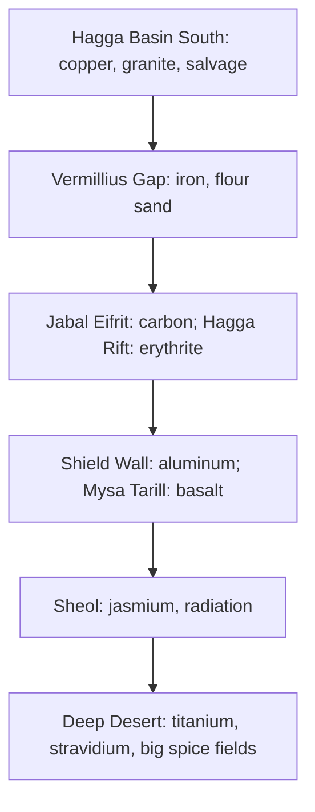

---json
{
  "schema": "dune-guide/v1",
  "title": "Where are the rare resources",
  "description": "Short map of the scarce materials: Deep Desert titanium and stravidium, Sheol jasmium, Rift erythrite, loot-only components and spice-infused dusts, plus unreleased Polar Sink items.",
  "kind": "tip",
  "section": "resources",
  "tags": ["rare", "rare resources", "deep desert", "endgame", "titanium", "stravidium", "jasmium", "erythrite", "components", "spice-infused", "polar sink"],
  "aliases": ["where to find rare materials", "deep desert only resources", "endgame materials"],
  "related": ["resources/titanium-ore", "resources/stravidium-mass", "resources/jasmium-crystal", "resources/erythrite-crystal", "spice/spice-infused-materials", "resources/index"],
  "game_version": "1.5.x",
  "last_researched": "2026-10-13",
  "confidence": "medium"
}
---

# Where are the rare resources

The game's own progression tutorial lays out the ladder (game text): copper in Hagga Basin South, iron in the Vermillius Gap, carbon in Jabal Eifrit, aluminum in the Shield Wall, jasmium "in the radioactive pools in Sheol", and titanium and stravidium "from the Deep Desert". Each step needs a better cutteray, a hazard crossed, or both.

## Raw materials

| Resource | Only found | Gate | Entry |
|---|---|---|---|
| Titanium Ore, Stravidium Mass | Deep Desert (rock outcrops; stravidium scarcer and denser farther north) | Cutteray Mk5; weekly Coriolis wipe; PvP north on official servers | [titanium-ore](titanium-ore.frontmatter.md), [stravidium-mass](stravidium-mass.frontmatter.md) |
| Jasmium Crystal | Sheol radioactive pools | Cutteray Mk4 and radiation protection | [jasmium-crystal](jasmium-crystal.frontmatter.md) |
| Erythrite Crystal | Hagga Rift mining galleries and CHOAM facilities; Blushing Cavern | Cutteray Mk2, guarded facilities | [erythrite-crystal](erythrite-crystal.frontmatter.md) |
| Agave Seeds | The O'odham | By hand | [agave-seeds](agave-seeds.frontmatter.md) |
| Large spice fields | Deep Desert | Worms, PvP | [spice/spice-fields](../spice/spice-fields.frontmatter.md) |

## Loot-only materials (no node to mine)

All game text unless tagged; the region in the item description is where that tier drops.

| Material | Where |
|---|---|
| Spice-infused Copper, Iron, Steel, Aluminum, Duraluminum, Plastanium Dust (unique-item components) | Secure containers of "the most powerful groups"; guides point to rare containers in wrecks and testing stations (community, https://www.method.gg/dune-awakening/where-to-find-spice-infused-duraluminum-dust-in-dune-awakening). See [spice/spice-infused-materials](../spice/spice-infused-materials.frontmatter.md) |
| EMF Generators (cutterays), Micro-sandwich Fabric (stillsuits) | Fremen caves; tier names Enhanced, Efficient, Overtuned/Durable, Advanced follow Jabal Eifrit and Rift, Shield Wall and O'odham, Sheol, Deep Desert |
| Servoks and Particle Capacitors | Imperial Testing Stations, by region the same way |
| Mechanical Parts and Plasteel Microflora Fiber | Shipwrecks, by region |
| Thermoelectric Cooler (Mk5 and Mk6 tools) | Deep Desert Shield Wall |
| Irradiated Slag (Power Pack Mk5, spice fuel) | "Radiated Core in the Sheol" |
| Diamondine Dust, Carbide Scraps | Guarded by the Maas Kharet at their sacred site (Mysa Tarill component ids `T4MysaTarilComponent1/2`) |
| Plastanium-tier components (Plasteel Plate, Irradiated Core, Advanced Machinery and others) | "Found in the Deep Desert, obtained from Landsraad rewards, or crafted in an Advanced Survival Fabricator" |
| Worm Tooth (`WormTooth`) | "Obtained from dying to the sandworm"; crafts an unfixed crysknife |

## Not in this build

Game text for build 25610213 contains placeholder (`PH_`) strings for Polar Sink materials: Glacial Ice, Deuterium, Chromium Mass/Ingot/Scraps, Core Fragments, Salvaged Plastic, Scrap Iron/Steel/Aluminum/Duraluminum/Plastanium, Thermocores, Cryo Foam and others. None is in the item list (item data; `items find` finds no Glacial Ice, Deuterium, Chromium or Salvaged Plastic), so treat them as unreleased.
