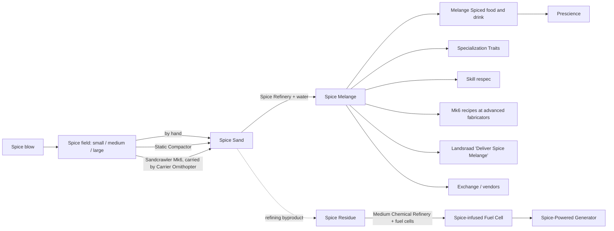

---json
{
  "schema": "dune-guide/v1",
  "title": "Spice (section overview)",
  "description": "Map of the spice entries: where spice sand comes from, how to harvest it safely, refining it into melange, and everything melange is used for.",
  "kind": "index",
  "section": "spice",
  "tags": ["spice", "melange", "spice sand", "spice field", "spice blow", "harvesting", "refining", "prescience", "index"],
  "aliases": ["spice index", "melange guide"],
  "related": ["endgame/index", "endgame/deep-desert"],
  "game_version": "1.5.x",
  "last_researched": "2026-10-13",
  "confidence": "high"
}
---

# Spice

Spice Sand is gathered at spice fields left by spice blows, refined with water into Spice Melange at a Spice Refinery, and melange is then spent on Specialization Traits, respecs, crafting, Landsraad deliveries and trade (game text). Hagga Basin only has small fields; medium and large fields are in the Deep Desert (wiki, https://awakening.wiki/Spice_Fields, 2026-09-19; server config).

| Entry | Covers |
|---|---|
| [spice-fields](spice-fields.frontmatter.md) | Field sizes, where each spawns, how many exist at once, yields |
| [spice-blows](spice-blows.frontmatter.md) | How a blow builds up and erupts, the danger zone, when to move in |
| [harvesting-by-hand-and-compactor](harvesting-by-hand-and-compactor.frontmatter.md) | Hand gathering, the Static Compactor family, spice mask, skills that raise yield |
| [sandcrawler-and-carrier](sandcrawler-and-carrier.frontmatter.md) | The Mk6 harvesting vehicle and the ornithopter that ferries it |
| [harvesting-worm-risk](harvesting-worm-risk.frontmatter.md) | Sandworm threat while harvesting, this server's values, grandfather worms |
| [refining-melange](refining-melange.frontmatter.md) | Small, Medium and Large Spice Refinery ratios, bonus yield, this server's instant refining |
| [melange-uses](melange-uses.frontmatter.md) | Traits, respec, crafting, Landsraad, generator fuel |
| [prescience-and-addiction](prescience-and-addiction.frontmatter.md) | Prescience, withdrawal, tolerance, spiced consumables, the spice mask |
| [spice-infused-materials](spice-infused-materials.frontmatter.md) | Spice-infused metal dusts for Unique gear, Spice Residue, spice fuel cells |
| [selling-spice](selling-spice.frontmatter.md) | Vendor vs Exchange prices, Landsraad spice tax decrees |
| [deep-desert-spice](deep-desert-spice.frontmatter.md) | Medium and large fields, the Deep Desert journey, PvP yield, the weekly wipe |

Related chapters: [../survival-combat-crafting.md](../survival-combat-crafting.md) (Spice section and refining table), [../economy-social-versions.md](../economy-social-versions.md) (Spice economics), [../world-and-maps.md](../world-and-maps.md) (sandworms, spice blows).
