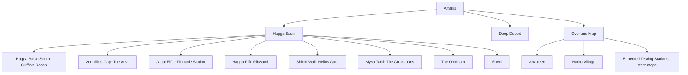

---json
{
  "schema": "dune-guide/v1",
  "title": "Zones: regions, settlements and points of interest",
  "description": "Section overview: every region, settlement, tradepost, fortress and point-of-interest entry, organized region to place, plus the merchant directory.",
  "kind": "index",
  "section": "zones",
  "tags": ["index", "zones", "regions", "map", "locations", "where is", "tradepost", "settlement"],
  "aliases": ["zones index", "locations index", "map index"],
  "region": "All",
  "related": ["zones/merchant-directory", "zones/hagga-basin", "zones/travel-and-fast-travel", "residences/index"],
  "game_version": "1.5.x",
  "last_researched": "2026-10-13",
  "confidence": "high"
}
---

# Zones

One entry per region, settlement and family of points of interest. Each opens with a quick answer, then lists places (names from the game's own map strings), what the area is good for and where the enemies are. The overview chapter [../world-and-maps.md](../world-and-maps.md) holds the general rules (map servers, travel requirements, security zones, hazards); these entries add place-level detail.

To answer "where do I buy X", start at [merchant-directory](merchant-directory.frontmatter.md). For "where do I farm component X", use [loot-components-by-region](loot-components-by-region.frontmatter.md).

## Regions to places

| Region entry | Settlements and hubs | Other entries that cover its places |
|---|---|---|
| [hagga-basin](hagga-basin.frontmatter.md) (map overview) | | |
| [hagga-basin-south](hagga-basin-south.frontmatter.md) | [griffins-reach](griffins-reach.frontmatter.md) | testing station No. 2, Wreck of the Alcyon, Mihna Cavern |
| [vermillius-gap](vermillius-gap.frontmatter.md) | [the-anvil](the-anvil.frontmatter.md) | Ironworks, Pallas, Actaeon, three Aql trials |
| [jabal-eifrit](jabal-eifrit.frontmatter.md) | [pinnacle-station](pinnacle-station.frontmatter.md) | Hand of Khidr, Tisiphone, Devil's Eye Cavern |
| [hagga-rift](hagga-rift.frontmatter.md) | [riftwatch](riftwatch.frontmatter.md) | CHOAM Mineral Extraction Facilities, Kytheria, erythrite |
| [shield-wall](shield-wall.frontmatter.md) | [helius-gate](helius-gate.frontmatter.md) | Sietch Ta'lab, Limos, Alecto |
| [mysa-tarill](mysa-tarill.frontmatter.md) | [the-crossroads](the-crossroads.frontmatter.md) | wrecked power station, Ruined Landing Pad |
| [the-oodham](the-oodham.frontmatter.md) | | pyon villages, Kynes's Promise, The Beast's Claw |
| [sheol](sheol.frontmatter.md) | | Edge of Acheron, circle caves, five wrecks (some in sections) |
| [deep-desert](deep-desert.frontmatter.md) | | Shield Wall caves, wrecks, testing stations |
| [overland-map](overland-map.frontmatter.md) | [arrakeen](arrakeen.frontmatter.md), [harko-village](harko-village.frontmatter.md) | story maps, themed testing stations, Polar Sink |

## Cross-cutting entries

| Entry | Answers |
|---|---|
| [merchant-directory](merchant-directory.frontmatter.md) | Where to buy any item; bankers; recustomization |
| [travel-and-fast-travel](travel-and-fast-travel.frontmatter.md) | Taxis, prices, respawn points, region order |
| [imperial-testing-stations](imperial-testing-stations.frontmatter.md) | Every numbered station and its loot tier |
| [shipwrecks](shipwrecks.frontmatter.md) | Every wreck by region |
| [caves-and-trials-of-aql](caves-and-trials-of-aql.frontmatter.md) | Trial of Aql caves in order; cave counts |
| [loot-components-by-region](loot-components-by-region.frontmatter.md) | Component tier per region and place |

## Known gaps

- No coordinates: the game text has none, and this guide does not copy map-site coordinates.
- Level numbers per region are not in the game text; the journey decks (early, mid, late, endgame) are used as the level band.
- Region placement of Pinnacle Station and The Crossroads differs between the game's map keys and the wiki; both are recorded in their entries.
- The Exchange UI names three exchanges, "Arrakis", "Harko Village" and "Windsack" (game text). Where Windsack is (if anywhere players can reach) is unknown; "Windsack Patrol" NPCs exist (game text).
