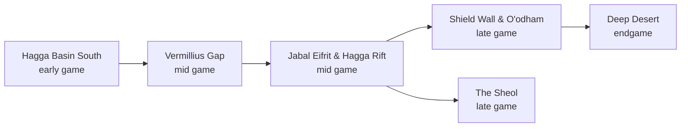

---json
{
  "schema": "dune-guide/v1",
  "title": "Travel, taxis and respawn points",
  "description": "How to get around: thopter taxis and their prices, which places are respawn points, crossing worm sand, vehicles that can or cannot change maps, and the order regions open up.",
  "kind": "system",
  "section": "zones",
  "tags": ["travel", "fast travel", "taxi", "ornithopter pilot", "respawn", "spawn point", "progression", "level band", "route"],
  "aliases": ["fast travel", "teleport", "taxi service", "thopter pilot", "how do I get to"],
  "region": "Hagga Basin, Overland Map",
  "related": ["zones/overland-map", "zones/griffins-reach", "zones/the-anvil", "zones/pinnacle-station", "zones/the-crossroads", "zones/arrakeen", "zones/harko-village"],
  "game_version": "1.5.x",
  "last_researched": "2026-10-13",
  "confidence": "high"
}
---

# Travel, taxis and respawn points

Quick answer: there is no free teleport. Pay an ornithopter pilot (500 Solari to a social hub, 150 to a tradepost since 1.5; patch notes 1.5.1.0 PTC, https://duneawakening.com/news/public-test-client-patch-1-5-1-0/), drive, or fly your own thopter. Pilots accept inventory or bank Solari since Chapter 3 (patch notes, via [../economy-social-versions.md](../economy-social-versions.md)). Respawn options on death include the four tradeposts, Imperial Testing Stations and shipwrecks (game text `SPAWN_LOC_*`), plus bases where you hold the respawn permission (game text, via [../bases-and-building.md](../bases-and-building.md)).

## Taxi stands

| Place | Pilot |
|---|---|
| Griffin's Reach, The Anvil, Pinnacle Station, The Crossroads | Thopter pilot at each (wiki, Tradeposts; game text journey "Talk to the ornithopter pilot") |
| Harko Village | Ornithopter Pilot at Spire Keep; Artyom Belov to the Neo Carthag Arena (wiki) |
| Arrakeen | Not named on the wiki. The district name "Arrakeen Depot" (game text) suggests the landing area; unverified. |

## Order the regions open (journey decks, game text)

The decks are labeled early, mid, late and endgame in their keys (game text). The game text gives no character-level numbers per region; use the deck as the level band.

## Ground travel rules

- Ground vehicles cannot leave their map (wiki, Ornithopter; game text "Only flying vehicles").
- Crossing sand: shortest line, low vibration, rock to rock; worm threat on sand does not decay while you stand still (server config; see [../world-and-maps.md](../world-and-maps.md)).
- From Hagga Basin South to the Vermillius Gap, the game recommends the flattest route "just northeast of the Griffin's Reach" (game text). The Anvil's recruitment contracts and Myr Charki's courier contract warn a vehicle is needed (game text).
- If you lose your sandbike near The Anvil, its garage lets you claim a partially damaged one (wiki, Tradeposts). The wiki says the same of Pinnacle Station, but that page appears copied from the Anvil one (unverified).
